# NeoMedia

**Your on-device media hub — novels, comics, music, and settings in one place.**

NeoMedia is for people who want books, comics, and music to stay on their phone: open and read, open and listen. **No accounts, no cloud sync, no Pro paywall.** The UI follows Material Design 3 with solid content cards and light frosted chrome that stay readable in light and dark.

> The repo / app transitional name was **NeoReader**; the product story is **NeoMedia**.

**Repo:** <https://github.com/wiwcn/NeoReader>  
中文说明 → [README_cn.md](./README_cn.md)

---

## What we promise

- **Offline-first** — library, progress, and playlists live on your device
- **No account / cloud / Pro** — install and use; nothing gated behind a subscription
- **One shell, four tabs** — Novels, Comics, Music, Settings
- **MD3 + calm chrome** — solid cards, light frost on bars, readable for long sessions
- **Ready on first open** — a few **public-domain classics with covers** and **CC0 sample tracks** are seeded so you can try reading and listening immediately

---

## Screenshots

Light and dark sets, captured from real UI widgets (~1080×2340). Library shots show real public-domain titles (Alice, Aesop, 《詩經》, and more).

### Shell

| Novels | Comics | Music | Settings |
| :---: | :---: | :---: | :---: |
| 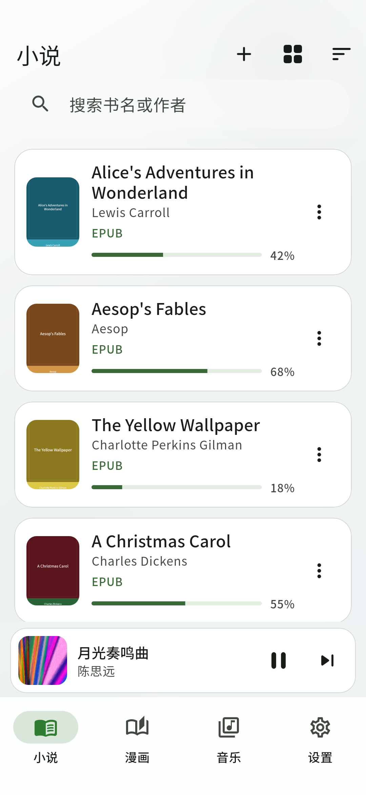 | 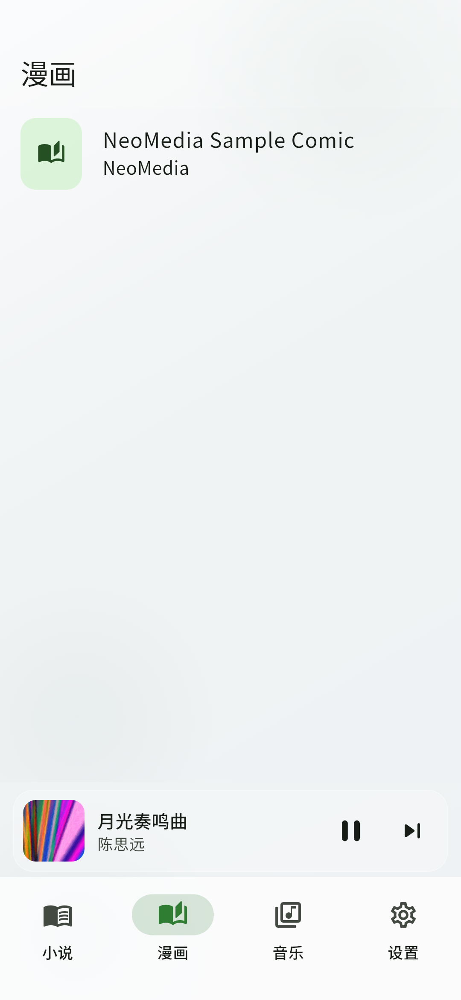 | 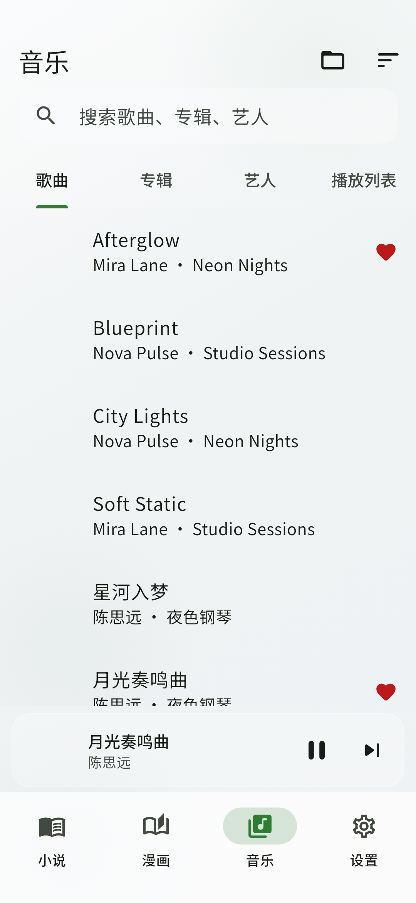 | 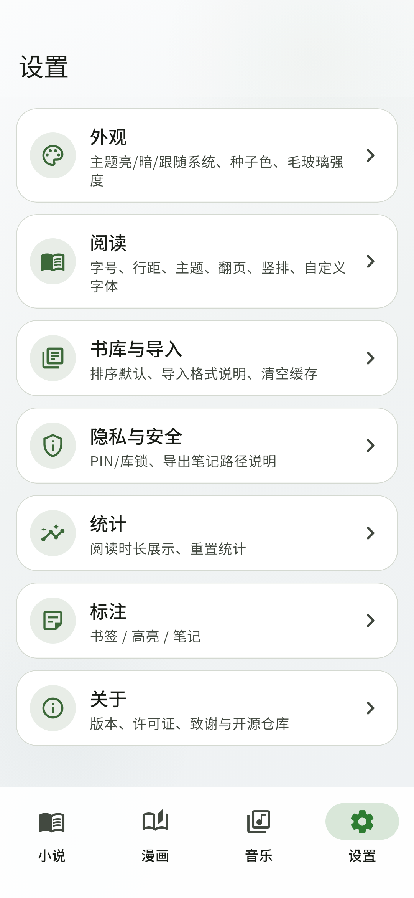 |

| Novels · dark | Comics · dark | Music · dark | Settings · dark |
| :---: | :---: | :---: | :---: |
| 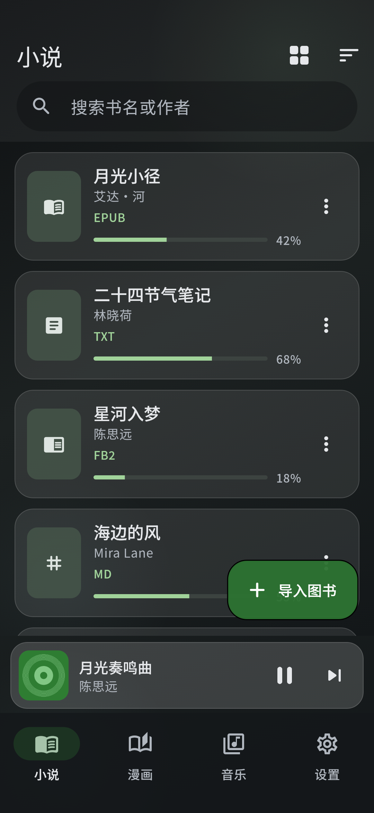 | 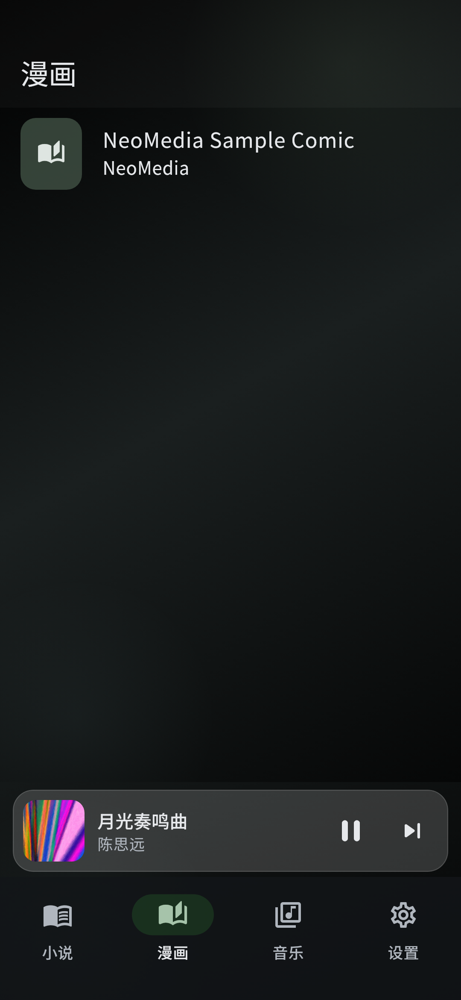 |  | 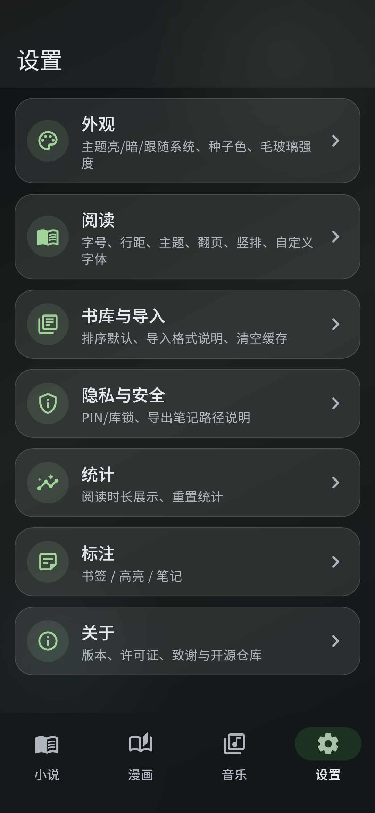 |

### Music & reader

| Now Playing | Albums | Mini player | Reader |
| :---: | :---: | :---: | :---: |
| 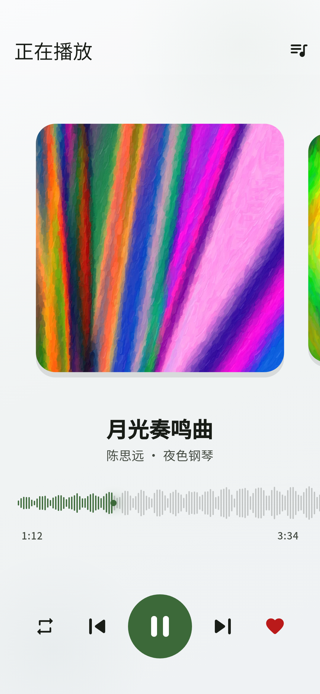 | 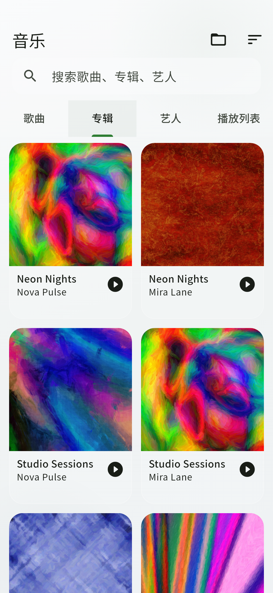 | 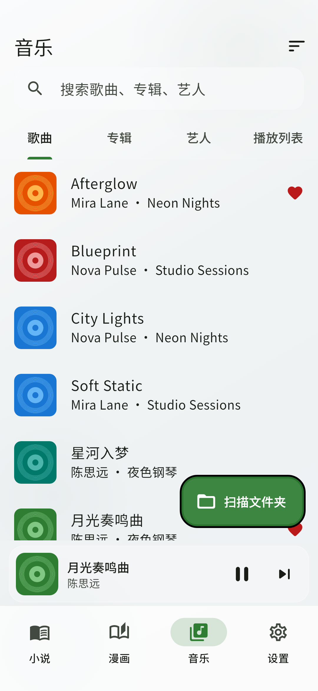 | 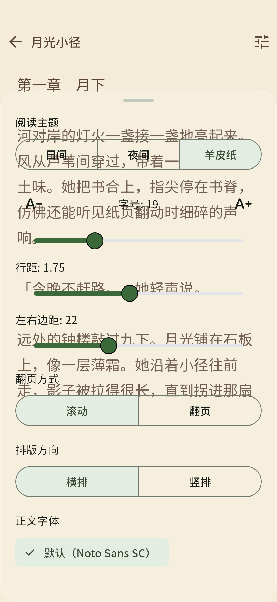 |

| Now Playing · dark | Albums · dark | Mini · dark | Reader · dark |
| :---: | :---: | :---: | :---: |
| 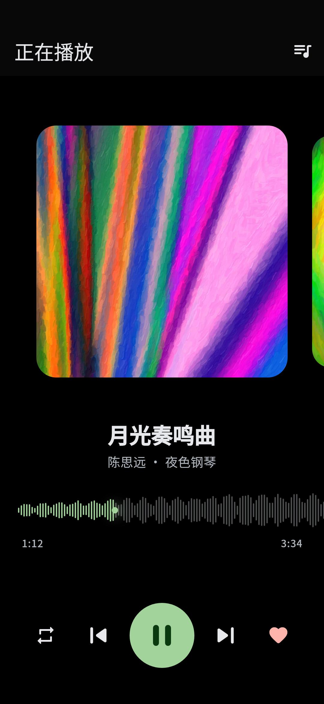 | 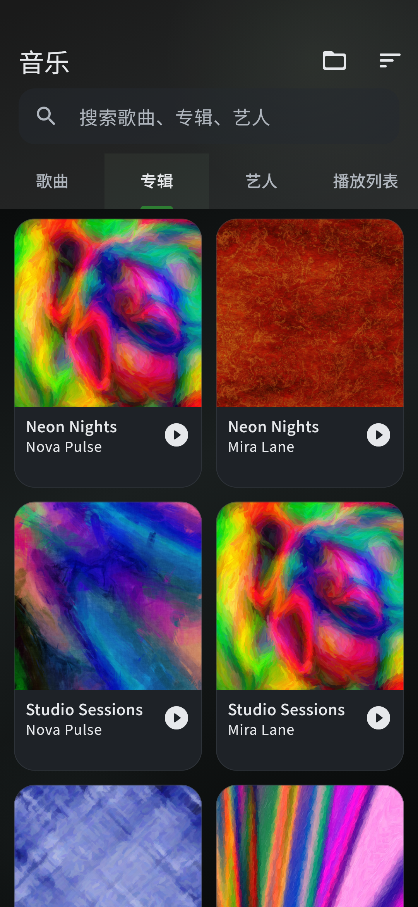 | 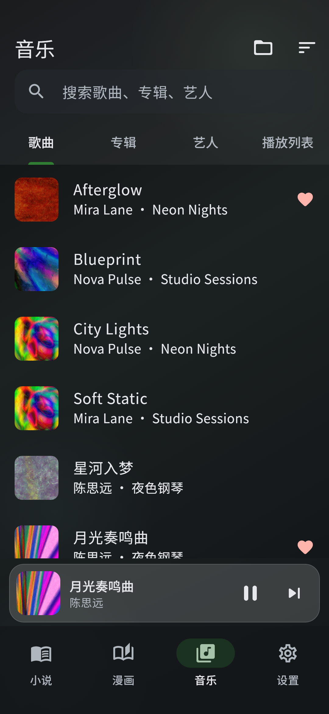 | 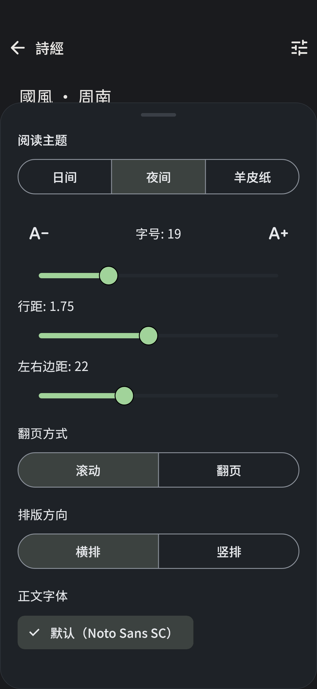 |

### Extra

| Empty library | Reading stats |
| :---: | :---: |
| 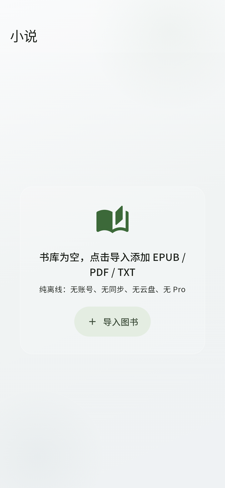 | 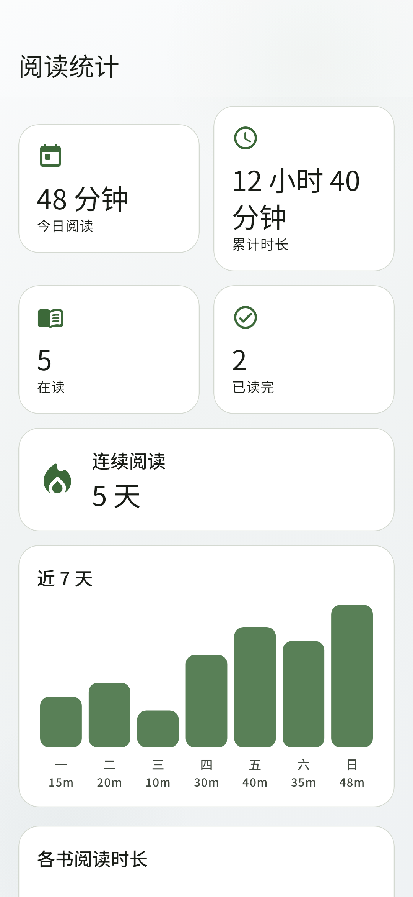 |

| Empty · dark | Stats · dark |
| :---: | :---: |
| 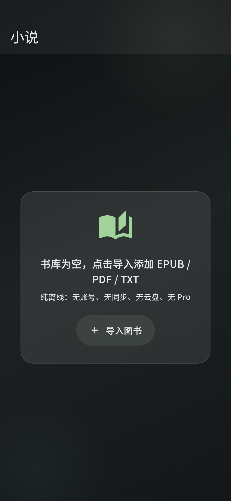 | 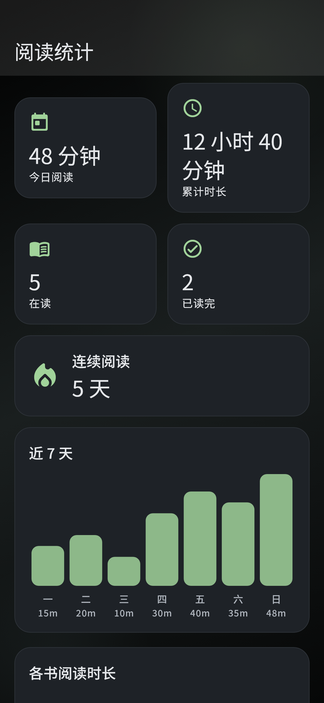 |

---

## What you can do

### Novels
Import local EPUB, PDF, TXT, MOBI/AZW3, FB2, Markdown, HTML, DOCX, and more. Search, sort, and pick up where you left off. Tune font size, line height, and day / night / sepia themes. Jump chapters from the table of contents, and optionally rewrite Taiwan/Mainland wording on display only. Bookmarks, notes, and highlights stay on device. The reader chrome uses frosted-glass controls that stay out of the way.

### Comics
A dedicated comics tab for local CBZ and similar archives — separate from novels, so your shelves stay clear.

### Music
Scan tracks on the phone and listen to full albums offline. Now Playing uses a **real waveform** you can scrub — not a decorative wave. A mini player follows you across novels, comics, and settings. Playlists, favorites, and the queue live on the device.

### Settings & stats
Light / dark, language, and reading defaults in one place. See how long you read today and how many days in a row — all local, never uploaded.

### Sample content
First launch seeds a small shelf of **public-domain** books (Project Gutenberg classics such as *Alice*, *Aesop*, *The Yellow Wallpaper*, *A Christmas Carol*, and Chinese 《詩經》) **with covers**, plus a tiny original sample comic, and **CC0** instrumental tracks for music. Swap them for your own library whenever you like — sources and licenses are listed in [ATTRIBUTION.md](./ATTRIBUTION.md).

---

## Platforms

Android / iOS.

---

## Looking ahead

We’d rather deepen what already feels good than pile on buzzwords:

- Richer music: EQ, smoother queues, optional lyrics
- Stronger comics: more archive formats and nicer page turns
- Kinder reading: vertical / dual-column layouts, on-device dictionary / TTS (still offline)
- Calmer library chores: batch import, tidy shelves, local backups
- Further out: local interactive titles such as GalGame — later, after the three tabs feel great

---

## Inspiration

Shell organization takes cues from [Fushi](https://github.com/hajisensai/Fushi). Music Now Playing’s quiet focus nods to [Harmonoid](https://github.com/harmonoid/harmonoid). NeoMedia reimplements the offline experience in Flutter.

---

## License

[GNU General Public License v3.0](./LICENSE) (GPL-3.0).

---

## Acknowledgments

Feature scope was inspired by the offline capability list of open-source [Koodo Reader](https://github.com/koodo-reader/koodo-reader); this repository’s Flutter code is an independent implementation. Fonts, sample books / music, motion packages, and other credits: [ATTRIBUTION.md](./ATTRIBUTION.md).
