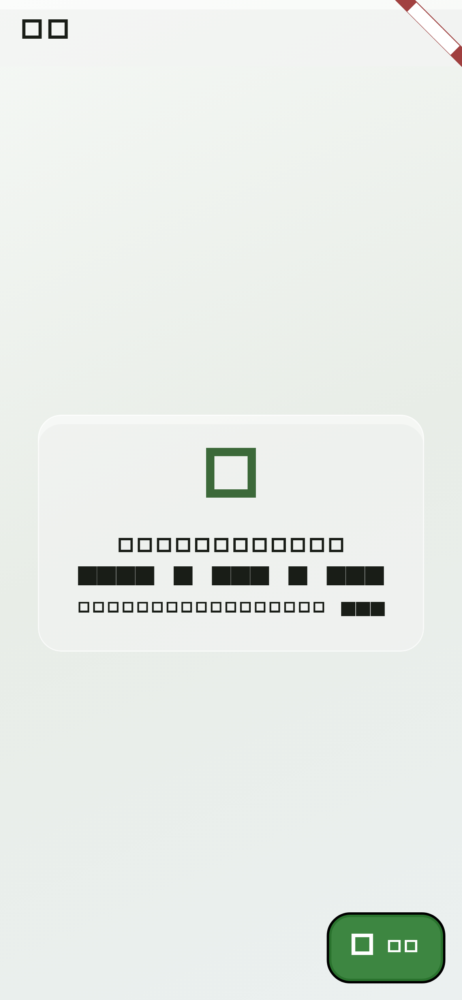
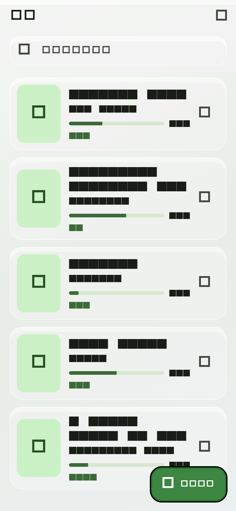
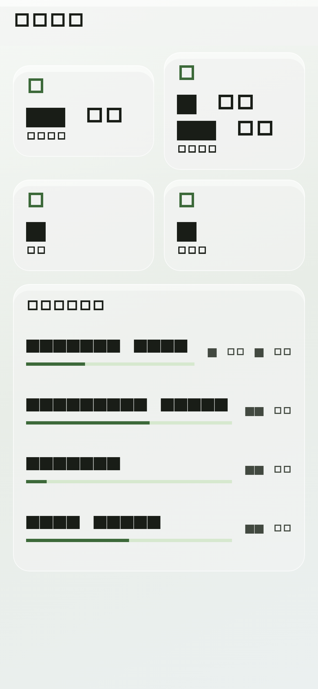
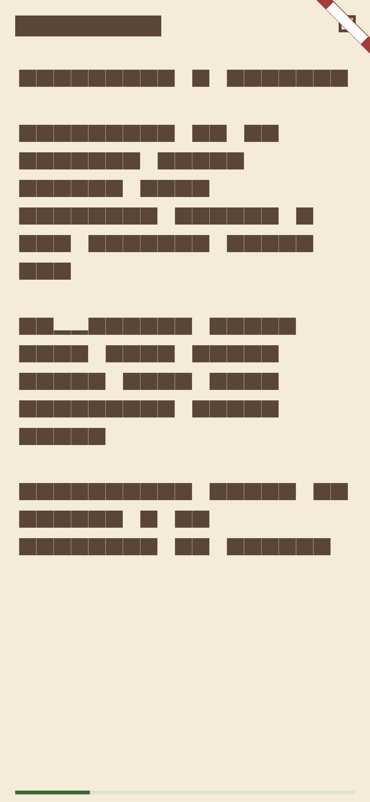

# NeoReader

[](./LICENSE)
[](https://flutter.dev)
[](#平台目标)
[](#)

**NeoReader** 是开源、免费的 **Flutter 离线电子书阅读器**（Android / iOS 优先）。  
界面采用 **Material Design 3 + 毛玻璃**。本地书库 **无数量上限**。  
**无账号、无同步、无云盘、无 Pro。**

功能蓝本对齐开源 [Koodo Reader](https://github.com/koodo-reader/koodo-reader) 的离线能力；本仓库的 Flutter 代码为独立实现（详见 [ATTRIBUTION.md](./ATTRIBUTION.md)）。

**仓库：** <https://github.com/wiwcn/NeoReader>

| | |
|---|---|
| English | [README.md](./README.md) |
| 路线图 | [ROADMAP.md](./ROADMAP.md) |
| 许可 | [GPL-3.0](./LICENSE) |

## 界面截图

截图来自真实 NeoReader Flutter 界面组件：

| 空书库 | 书库列表 | 导入入口 |
| :---: | :---: | :---: |
|  |  |  |

| 阅读统计 | 设置 | 阅读器 |
| :---: | :---: | :---: |
|  |  |  |

## 功能一览

### 当前可用

| 模块 | 说明 |
|------|------|
| 书库 | 导入 / 搜索 / 排序 / 删除，本地无限本 |
| 格式 | **EPUB**、**PDF**、**TXT**、**MOBI/AZW/AZW3**（无 DRM 文本提取）、**FB2**、**CBZ**（及部分 ZIP 伪装的 CBR）、**Markdown**、**HTML/XHTML/MHTML**、**DOCX**（正文提取） |
| 阅读 | 日间 / 夜间 / 羊皮纸主题，字号与行距，进度，书签与笔记 |
| 统计 | 今日 / 累计阅读时长、各书时长（相对 Koodo 的增强） |
| 设计 | MD3 动态配色、毛玻璃表面、深浅色 |
| 隐私 | 天生纯离线 |

### 路线图（已占位）

竖排 / 双栏、本地 TTS、词典、OCR、笔记导出、PIN、完整 RAR/7z 漫画、更丰富图表等，见 [ROADMAP.md](./ROADMAP.md)。目标：对齐 Koodo 离线能力 **一个不少**，并保留 NeoReader 自有增强。

## 平台目标

- **Android：** minSdk **29**（Android 10+）
- **iOS：** 部署目标 **12.0+**
- **HarmonyOS：** Android APK 常可在兼容层侧载。尽量避免非必要的 Google 专有 API。尚未宣称 HarmonyOS NEXT / OpenHarmony 原生打包；DRM 与部分系统能力可能受限。

## 快速开始

```bash
git clone https://github.com/wiwcn/NeoReader.git
cd NeoReader
flutter pub get
flutter run
```

首次启动会从 `assets/samples/` 导入示例书（TXT、MD、HTML、FB2、CBZ、DOCX）。

## 打包 APK

```bash
flutter pub get
flutter build apk --debug
# 产物：build/app/outputs/flutter-apk/app-debug.apk

# 正式发布需自行配置签名：
# flutter build apk --release
```

## 参与贡献

欢迎 Issue 与 PR。请保持纯离线原则（不要引入云同步 / 账号 / Pro）。UI 变更请延续 MD3 + 毛玻璃风格。提交前请运行 `flutter analyze`。

## 许可证

[GNU General Public License v3.0](./LICENSE)（**GPL-3.0**）。

NeoReader 为原创 Flutter 实现；Koodo Reader 仅作为**功能灵感**致谢，本仓库不包含其 AGPL 源码。详见 [ATTRIBUTION.md](./ATTRIBUTION.md)。
